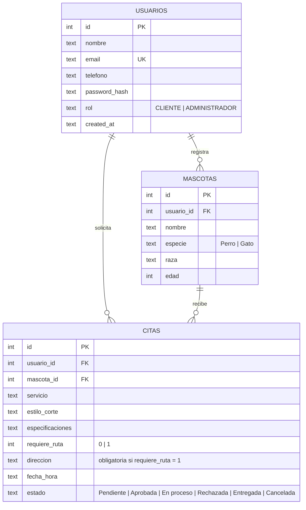

# Modelo de datos · PetStyle (SQLite)



## Reglas de integridad
- `usuarios.email` es único (sin distinguir mayúsculas).
- Borrar un usuario borra sus mascotas (`ON DELETE CASCADE`).
- **No** se puede borrar una mascota que tenga citas (`ON DELETE RESTRICT`).
- Las contraseñas se guardan con bcrypt (`password_hash`), nunca en texto plano.

## Ciclo de estados de una cita
```
Pendiente ──► Aprobada ──► En proceso ──► Entregada
    │             │
    │             └──► Rechazada          (administrador)
    ├──► Rechazada                        (administrador)
    └──► Cancelada                        (cliente, solo si sigue Pendiente)
```
El esquema completo está en [`database/schema.sql`](../database/schema.sql).
